# Smriti

<p align="center"></p>

Smriti (स्मृति, "memory") is a personal tracker for your work and for what you learn. You plan the
day, move tasks across a board, log the time you spend, keep a reading list, and come back to ideas
before you forget them.

It runs on your own computer in one Docker container and keeps everything in one SQLite file. There is
no account and no cloud. The only outside calls are optional lookups (a page's title when you paste a
link, book details from Open Library), and you can turn those off.

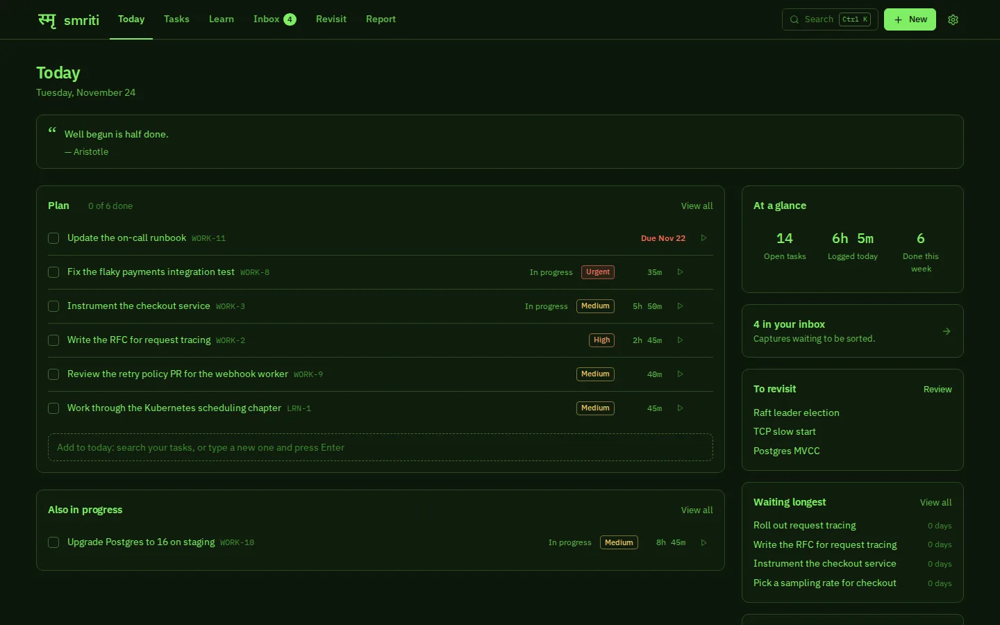

## A quick tour

<table>
  <tr>
    <td width="50%" valign="top">
      <b>Today</b><br>
      <sub>Your plan for the day. Tick tasks off, start a timer, and see what else needs you.</sub><br><br>
      
    </td>
    <td width="50%" valign="top">
      <b>Tasks: board</b><br>
      <sub>To do, Doing and Done. Drag a card to move it. Children show their parent (↳ WORK-1), parents their progress (1/3).</sub><br><br>
      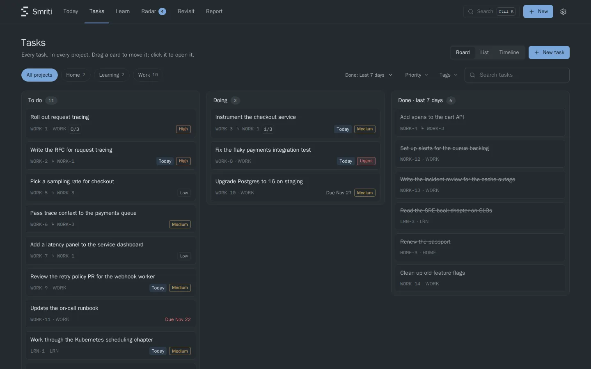
    </td>
  </tr>
  <tr>
    <td width="50%" valign="top">
      <b>Tasks: list</b><br>
      <sub>Every task in one sortable table, with each child's parent and each parent's progress.</sub><br><br>
      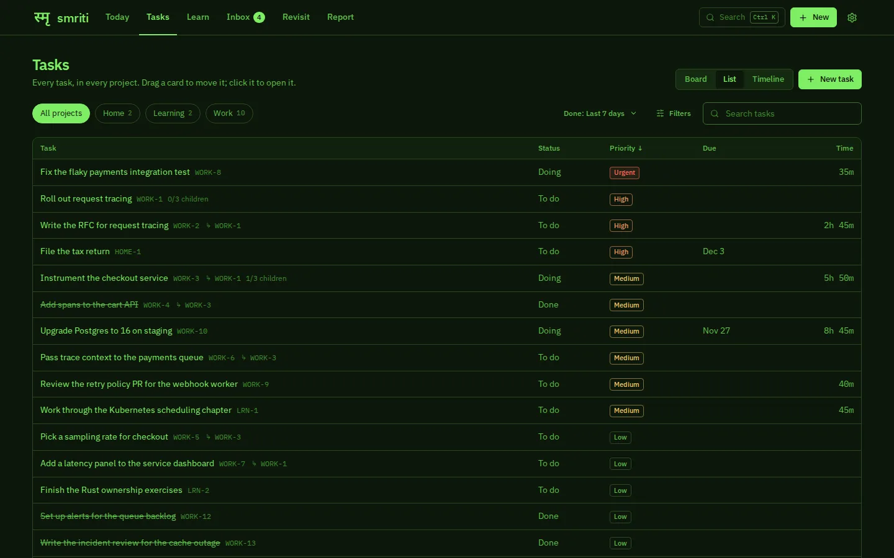
    </td>
    <td width="50%" valign="top">
      <b>Tasks: timeline</b><br>
      <sub>A day drawn like a trace: one row per task, a bar for each stretch of work.</sub><br><br>
      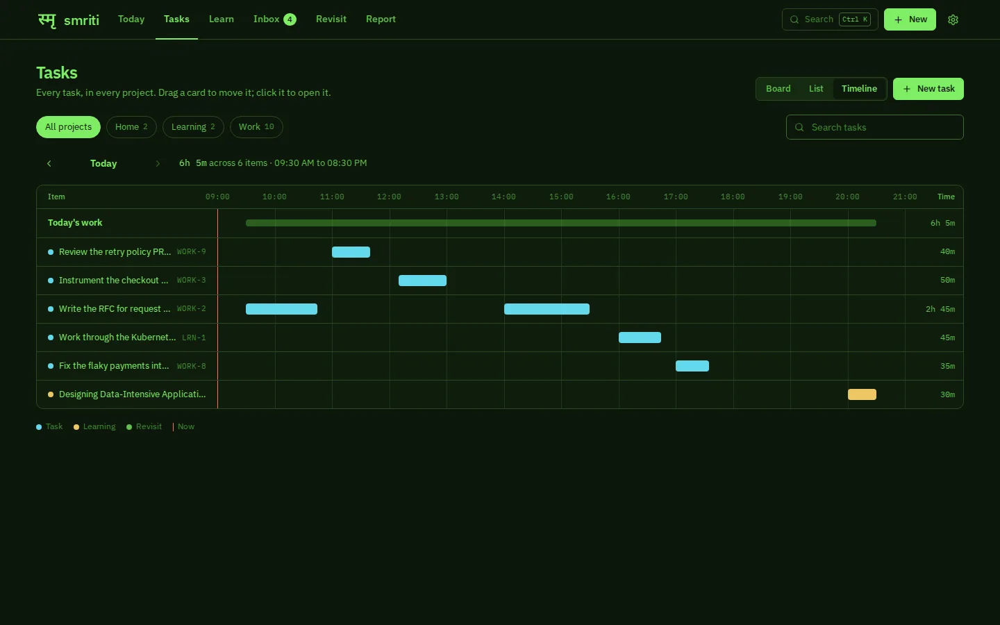
    </td>
  </tr>
  <tr>
    <td width="50%" valign="top">
      <b>A task</b><br>
      <sub>The chain above it (WORK-1 › WORK-3), checklist, child tasks, time and notes.</sub><br><br>
      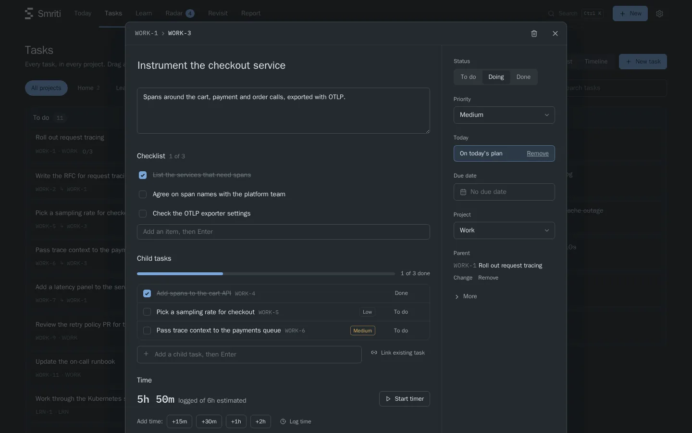
    </td>
    <td width="50%" valign="top">
      <b>Child tasks</b><br>
      <sub>Like Jira: add a child or link an existing task. A child can have children of its own.</sub><br><br>
      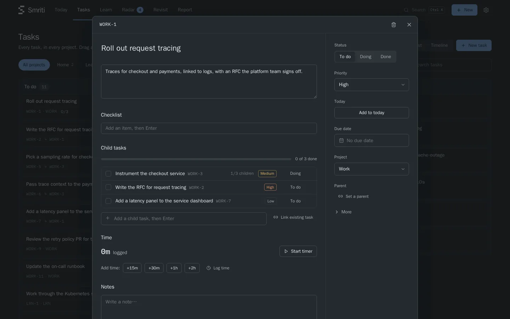
    </td>
  </tr>
  <tr>
    <td width="50%" valign="top">
      <b>Learn</b><br>
      <sub>Topics, articles, books and videos, with reading progress for books.</sub><br><br>
      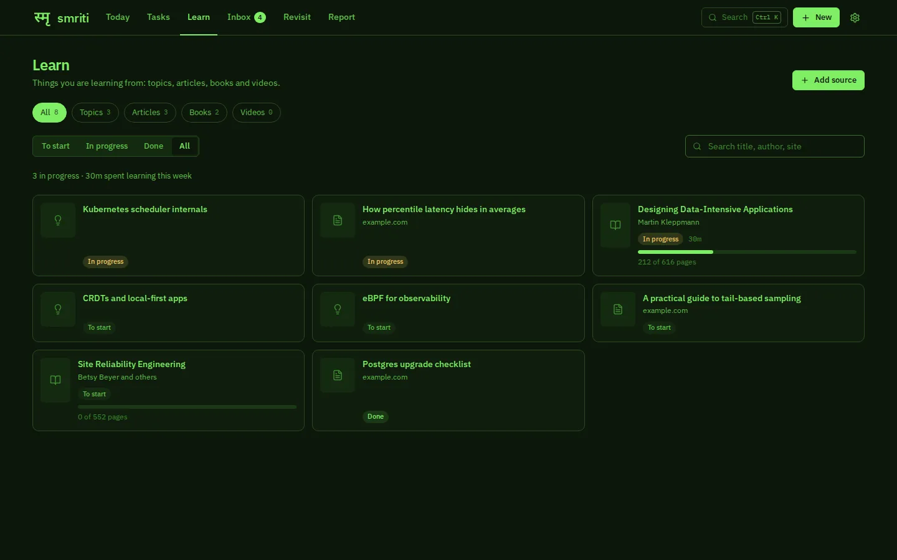
    </td>
    <td width="50%" valign="top">
      <b>Revisit</b><br>
      <sub>Ideas and questions you want to keep fresh. Open one to read it again.</sub><br><br>
      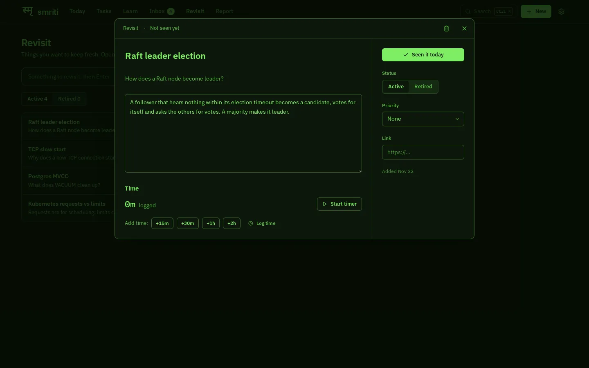
    </td>
  </tr>
  <tr>
    <td width="50%" valign="top">
      <b>Radar</b><br>
      <sub>Jot something down now. Later, make it a task, a source or a revisit, or dismiss it.</sub><br><br>
      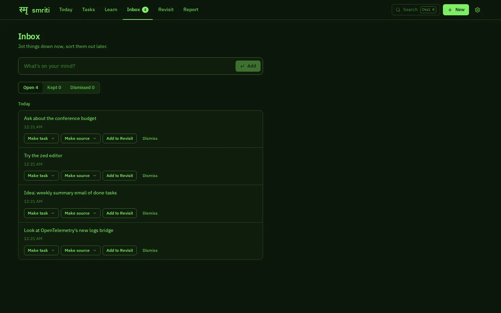
    </td>
    <td width="50%" valign="top">
      <b>Report</b><br>
      <sub>A week at a time: hours per day, time per project, what got done and what carried over.</sub><br><br>
      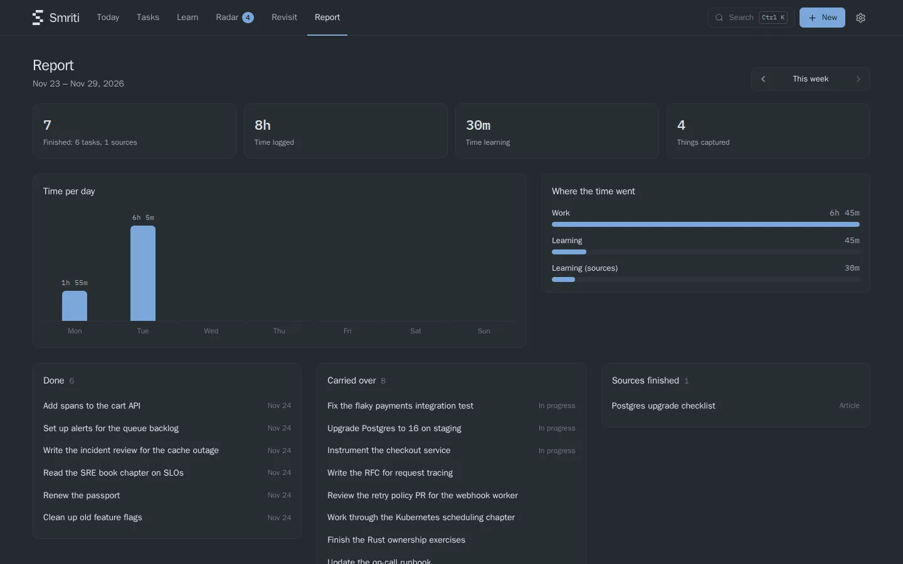
    </td>
  </tr>
</table>

<details>
<summary>The White and Black themes</summary>
<br>
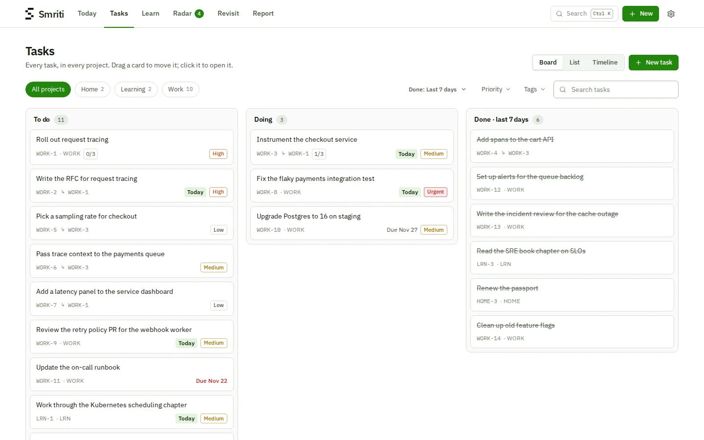
<br><br>
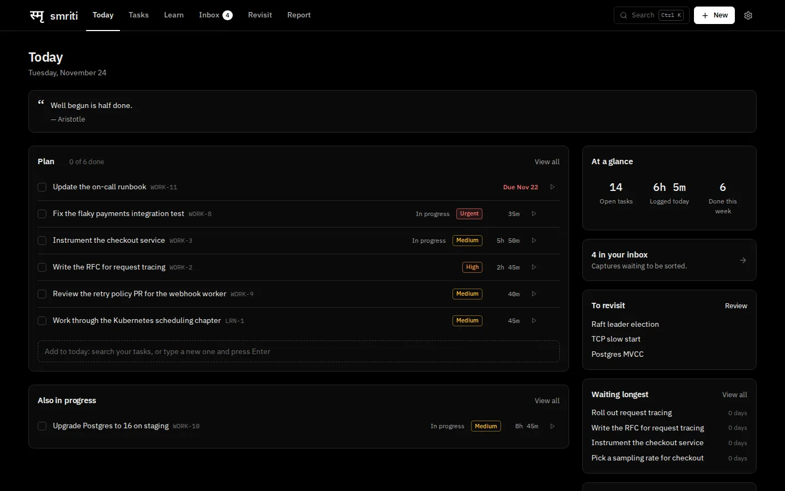
</details>

<sub>Screenshots use demo data.</sub>

## Set up

You need [Docker](https://docs.docker.com/get-docker/) (Docker Desktop or OrbStack on a Mac), `make` and
`git`. Everything else, including Python and Node.js, runs inside containers, so you don't install them.

1. Get the code.

   ```bash
   git clone <this repository's URL> smriti
   cd smriti
   ```

2. Start it.

   ```bash
   make up
   ```

   The first run copies `.env.example` to `.env`, builds the image (a few minutes the first time) and
   starts the container. When it's ready it prints the address: http://localhost:8090.

3. Open http://localhost:8090 and make your first project in Settings (gear icon, top right). A project
   has a name and a short key such as `WORK`, and every task in it gets a key like `WORK-12`. Then press
   `C` to add a task.

To stop Smriti, run `make down`. Your data stays in `data/smriti.db` and is there again on the next
`make up`.

### Use it from your phone

Smriti listens only on this computer by default. To open it from a phone on the same Wi-Fi, set
`SMRITI_BIND=0.0.0.0` in `.env`, run `make restart`, and open `http://<your-computer's-IP>:8090`.

Smriti has no login, so anyone on that network can then read and change your data. Only do this on a
network you trust.

### Coming from Arc

If you used Arc, Smriti can bring all of it across: tasks, time logs, comments and history, learning
items, articles and books with their collections, Radar captures, Revisit topics, daily reviews, quotes,
and Arc's trash. Notes Arc
saved to Obsidian stay linked, so Smriti updates them in place. Times
come across in your time zone, and task keys like `WORK-12` stay the same. The import only runs on an
empty Smriti.

```bash
sqlite3 /path/to/arc/data/arc.db ".backup 'import/arc.db'"
make import
```

The weekend planner is not part of Smriti, so it is left behind.

## What's inside

### Work

- Tasks live in projects and move from To do to Doing to Done. Each has a priority (Low, Medium, High
  or Urgent), an optional due date, tags, a checklist, notes and a history of changes. A task can repeat
  daily, on weekdays, weekly or monthly.
- Child tasks work like Jira's. Add a child from the parent's window, or link a task you already have;
  a child can have children of its own. The parent shows a progress bar of its children, each child shows
  the chain above it (`WORK-1 › WORK-5 › WORK-9`), and board cards show `↳ WORK-1` on a child and `2/5` on
  a parent. Closing a parent with open children asks whether to close them too, and deleting a parent
  sends its children to Trash with it.
- Today is your plan. Add a task to it from its window or from the box under the plan, where you can
  also type a new task and press Enter. Unfinished tasks from earlier days stay on the plan until you
  finish them or take them off.
- The Tasks page shows everything as a board, a list or a timeline. Filter by project, priority or tag.
  The Done column shows the last 7 days by default; switch it to Today, 30 days or all time.
- To log time, press play to start a timer, use +15m, +30m, +1h or +2h for work you just did, or choose
  Log time and type it as you would in Jira: `1h 30m`, `45m`, `2.5h`, `1:30` or `1d` (8 hours). The
  start time fills in as now minus the time spent. A task's estimate is written the same way.
- The Report covers one week: time per day, where the time went (each project, plus learning and Revisit,
  adding up to the week's total), what you finished (tasks and sources), what carried over, and your
  end-of-day notes.

### Learning

- Learn holds what you learn from: topics, articles, books and videos. Paste a link and Smriti fills in
  the title and site (YouTube videos get their thumbnail). Search Open Library to add a book with its
  cover and page count, then track how far you've read.
- Collections keep sources organised (AI, SRE, Databases...). They sit down the left of Learn: pick one
  to see only its sources, drag a card onto one to file it there, or use "Add to a collection" in the
  source's window. A source can be in several collections. A new article's note goes into a folder named
  after its first collection, as Arc did.
- Save any source to Obsidian with the gem icon (in its window, or on its card in Learn when you hover)
  as a Markdown note: title, link, tags, status, summary and your notes,
  with front matter you can query. Edit the source and its note updates. Smriti only touches notes it
  wrote, so a note of your own with the same name is never overwritten. Connect a vault first (see
  Configuration).
- Revisit is for things you want to keep fresh: an idea, a question to ask yourself, notes, a link.
  Press "Seen it today" when you've gone over one, and the ones you haven't seen in longest come first.
- Radar is for quick notes you'll sort later. Press `N` anywhere, type, and press Enter. From the
  Radar page, turn each one into a task, a source or a revisit item, or dismiss it.

### Everything else

- Search with `⌘K` (`Ctrl K`) finds tasks, sources, revisit items and Radar notes, and jumps to pages.
  Type a key like `WORK-12` to find that task.
- Deleted things go to Trash for 30 days, and you can restore them from there. Deleting a task, source or
  revisit item also shows an Undo button for a few seconds.
- Today shows one of your quotes and switches to a random one every 15 seconds. Add and edit them in Settings.
- There are three themes: Obsidian (slate and soft blue, after the "Claude Pane" Obsidian theme, in
  Anthropic Sans when it is installed), which is the default, Black and White. Choose one in Settings.
- On a phone, the page tabs move to a row you can scroll sideways.

## Keyboard shortcuts

| Keys | What it does |
| --- | --- |
| `⌘K` / `Ctrl K` | Search, or go to a page |
| `?` | Show all shortcuts |
| `C` | New task |
| `S` | New source |
| `R` | Add to Revisit |
| `N` | Add to Radar |
| `G` then `T`, `K`, `L`, `A`, `R`, `P` or `S` | Go to Today, Tasks, Learn, Radar, Revisit, Report or Settings |
| `Esc` | Close a window or dialog |

## Commands

Run `make` on its own to list these.

| Command | What it does |
| --- | --- |
| `make up` | Create `.env` if it's missing, build the image and start Smriti |
| `make down` | Stop Smriti |
| `make restart` | Rebuild and restart, for example after editing `.env` |
| `make logs` | Follow the logs |
| `make status` | Show whether the container is running and healthy |
| `make backup` | Copy the database to `data/backups/` |
| `make import` | Import an Arc database from `import/arc.db` |
| `make purge` | Remove trash older than 30 days now (it also happens at every start) |
| `make shell` | Open a shell in the running container |
| `make dev` | Run with live reload while you change the code |
| `make test` | Run the API tests |

## Configuration

Settings come from environment variables. `make up` creates `.env` from `.env.example`; edit it and run
`make restart`.

| Variable | Default | Meaning |
| --- | --- | --- |
| `SMRITI_PORT` | `8090` | Port on this computer |
| `SMRITI_BIND` | `127.0.0.1` | `127.0.0.1` keeps Smriti on this computer; `0.0.0.0` opens it to your network |
| `TZ` | `Asia/Kolkata` | Your time zone, used for "today", the timeline and reports |
| `SMRITI_TRASH_DAYS` | `30` | Days before deleted things are removed for good |
| `SMRITI_LOOKUP` | `on` | `off` stops link and book lookups, so Smriti makes no outside calls |
| `SMRITI_LOG_LEVEL` | `info` | How much the container logs |
| `SMRITI_VAULT_PATH` | (empty) | Full path of your Obsidian vault, or a folder inside it. Empty keeps Obsidian export off |
| `SMRITI_OBSIDIAN_FOLDER` | `Smriti/Learning` | Folder in the vault for topics, videos and books |
| `SMRITI_OBSIDIAN_ARTICLES_FOLDER` | `Smriti/Articles` | Folder in the vault for articles |
| `SMRITI_OBSIDIAN_AUTO` | `on` | `on` updates a note when you edit its source; `off` waits until you press the gem again |

Your theme, filters and similar choices are saved in your browser.

## Your data

Everything is in one file, `data/smriti.db`. `make backup` writes a dated copy to `data/backups/`, and
it's safe to run while Smriti is open. To move to another computer, copy the `data` folder across and
run `make up` there.

## Develop

`make dev` runs the API with reload on port 8090 and the web UI with hot reload on port 5190, both in
containers, with the code mounted from this folder. `make test` runs the API tests.

```
api/          FastAPI app (api/smriti), SQL migrations, tests
web/          React and TypeScript UI, built with Vite and Tailwind
docs/         SPEC.md (data model, API, configuration) and the README screenshots
data/         the database and backups (not in git)
import/       where an Arc database goes for `make import` (not in git)
```

Start with [docs/SPEC.md](docs/SPEC.md) for how Smriti stores things and what the API offers, and
[web/DESIGN.md](web/DESIGN.md) for how the UI is put together.

## Credits

The UI uses IBM Plex Sans and IBM Plex Mono.
